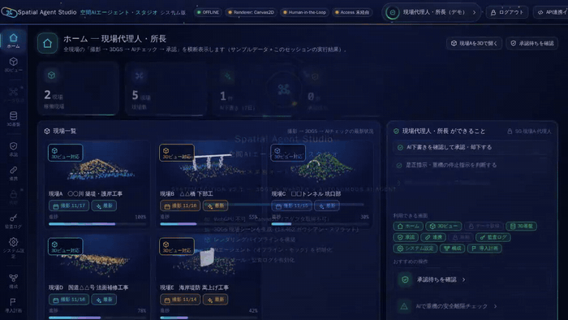

<p align="center">
  
</p>

<p align="center">
  <a href="LICENSE"></a>
  
  
  
  
  
  
</p>

<p align="center">
  <b>現場を3Dで見て、AIが計測・集計・帳票の下書きまで進める。確定は人が行う。</b><br>
  すべての操作と判断は、改ざん検知できる監査ログ（ハッシュ連鎖）に残ります。
</p>

<p align="center">
  <a href="#role-field"></a>&nbsp;&nbsp;
  <a href="#role-field"><b>現場代理人・管理者</b></a>　｜　
  <a href="#role-hq"></a>&nbsp;&nbsp;
  <a href="#role-hq"><b>本社・支店内現場管理者</b></a>　｜　
  <a href="#role-it"></a>&nbsp;&nbsp;
  <a href="#role-it"><b>IT・DX推進部 管理担当者</b></a>
</p>

---

## 🎬 30秒でわかる（実際の画面）

<p align="center">
  <a href="docs/media/demo.mp4"></a>
  <br><sub>▶ クリックで MP4（24秒・音声なし）｜ホーム → 3Dビュー → 承認 → 監査ログ → システム設定</sub>
</p>

<p align="center">
  
</p>

> **AIはデモです。** 本MVPの「AIエージェント」はスクリプト化されたデモで、外部LLM/APIへは接続しません。
> 数値は `src/shared/measurements.ts` の**決定的な計算エンジン**が算出し、**AIが数値を作ることはありません**。
> 現場・人物・数値はすべて架空のサンプルです。

---

## 👥 あなたの役割から読む

<table>
<tr>
<td width="33%" valign="top" align="center">
  <br>
  <b>現場代理人・管理者</b><br>
  <sub>現場を回す人／承認する人</sub>
</td>
<td width="33%" valign="top" align="center">
  <br>
  <b>本社・支店内現場管理者</b><br>
  <sub>複数現場を俯瞰する人</sub>
</td>
<td width="33%" valign="top" align="center">
  <br>
  <b>IT・DX推進部 管理担当者</b><br>
  <sub>権限・監査・環境を守る人</sub>
</td>
</tr>
<tr>
<td valign="top">
 夕方に集中する写真整理・集計・帳票作成を、AIの下書きに置き換えます。<b>あなたが決めるのは「承認」だけ</b>。3Dで現場を確認し、数値の根拠をその場で確かめられます。
</td>
<td valign="top">
  現場に行かずに、全現場の進捗・承認待ち・安全アラートを俯瞰できます。3Dで横断確認し、KPIと監査記録を根拠に現場へ指示できます。
</td>
<td valign="top">
  ロール権限・Cloudflare Access・監査チェーン・データ件数を1画面で確認。監査ログの検証とCSV出力、ロール割当の変更、CIゲートの運用まで担います。
</td>
</tr>
</table>

---

<a name="role-field"></a>

### 🦺 現場代理人・管理者のかたへ

**こんな毎日を置き換えます**：写真の整理 → 電卓 → 帳票 → 確認依頼。AIが下書きまで進め、あなたは内容を確かめて承認するだけ。

| できること | 画面 | ポイント |
| :-- | :-- | :-- |
| 3Dで現場を確認・計測（距離・面積・土量・断面） | **3Dビュー** | 設計との差分をヒートマップで表示。数値は計算エンジンが算出 |
| AIに出来形・安全・点検の下書きを作らせる | **3Dビュー / AIパネル** | 知覚 → 推論 → 操作 → 検証の6ステップを可視化 |
| **承認・却下**（確定・提出・停止） | **承認** | 承認してはじめてレポートが確定し、DBに残る |
| 安全離隔の判断（重機と作業員） | **3Dビュー** | 危険域・最小離隔・侵入時刻を提示。停止指示は人が決める |
| 監査ログの確認 | **監査ログ** | 誰が何をしたかをハッシュ連鎖で検証。CSVで持ち出せる |

**はじめの3分**

1. <https://spatial-agent-studio-preview.mirai-dx-platform.com> を開く（Cloudflare Access のメール認証）
2. ホームの現場カードから現場を選ぶ → **3Dビュー**で現場を見る
3. **承認**で下書きを確認 → **承認して確定** → 監査ログで記録を確認

> 🔐 **承認できるのは「現場代理人・所長」ロールだけ**です。ロールは Cloudflare Access のメールアドレスで自動的に決まり、右上のメニューには**付与されたロールだけ**が並びます。

---

<a name="role-hq"></a>

### 🏢 本社・支店内現場管理者のかたへ

**現場に行かずに、全現場の「いま」を判断できます。**

| できること | 画面 | ポイント |
| :-- | :-- | :-- |
| 全現場の進捗・承認待ち・安全アラートを俯瞰 | **ホーム** | KPIはDBの実データ。現場カードから即3Dへ |
| 複数現場を3Dで横断確認 | **3Dビュー** | 現場切替・版切替・計測。リモートパトロールに |
| 点検・安全パトロールの記録確認 | **承認 / 3Dビュー** | 下書きと判断の履歴を追える |
| KPI・傾向の分析 | **ホーム / レポート** | 承認待ち件数・AI下書き件数・削減時間（試算） |
| 監査の検証と持ち出し | **監査ログ** | 絞り込み・レコード詳細・ハッシュ再計算・CSV |

> ⚠️ 本社ロールは**承認はできません**（閲覧・分析・監査が中心）。承認は現場代理人・所長が行います。

---

<a name="role-it"></a>

### 🛠️ IT・DX推進部 管理担当者のかたへ

**権限・監査・環境を、画面と設定ファイルの両方から管理できます。**

| できること | 場所 | ポイント |
| :-- | :-- | :-- |
| ロール権限の確認（誰が何をできるか） | **システム設定 / 統制** | 4ロール×画面のマトリクスを実データで表示 |
| Cloudflare Access の状態と付与ロール | **システム設定** | 認証状態・メール（マスク）・付与ロール・セッション |
| 監査チェーンの検証とCSV出力 | **監査ログ** | 追記専用・SHA-256連鎖・ブラウザ側でも再計算 |
| 環境情報（版・DB・uptime・CORS） | **システム設定** | ヘルスチェックも画面から実行 |
| ロール割当の変更 | **ホスト上の割当ファイル** | 保存だけで反映（API再起動不要） |
| 配備・復旧・CI | **docs / CI** | `pnpm ci:local` が必須チェックを投稿 |

**運用の要点**

```bash
# ロール割当（メール → ロール）。保存するだけで反映されます。
~/.config/spatial-agent-studio/access-roles.txt   # 0600 / git管理外
# 形式（1行1件・先頭のロールが既定）:
#    someone@example.com,field,agent,hq,it
#    @example.co.jp,field

# 検証つきローカルCI（GitHubの ci/local-verify を投稿）
pnpm ci:local
```

- ロールキー：`field`（現場担当者） / `agent`（現場代理人・所長） / `hq`（本社） / `it`（IT・DX部門）
- 未割当のメールは **403（ROLE_NOT_MAPPED）**。SPAは最小権限で警告表示します。
- 実在のメールアドレスは**リポジトリに入れません**（ホスト上の0600ファイルのみ）。

---

## 🖥️ 11画面

| # | 画面 | 何ができる | 現場担当 | 代理人 | 本社 | IT・DX |
| :-: | :-- | :-- | :-: | :-: | :-: | :-: |
| 1 | **ホーム** | KPI・現場カード・承認待ち・おすすめ操作 | ✅ | ✅ | ✅ | ✅ |
| 2 | **3Dビュー** | 3D確認・計測・AIタスク・安全離隔 | ✅ | ✅ | ✅ | ✅ |
| 3 | **データ取得** | 撮影→3DGS化の6段階処理（サンプル） | ✅ | — | — | ✅ |
| 4 | **3D基盤** | 版管理・座標・アクセス権（サンプル） | ✅ | ✅ | ✅ | ✅ |
| 5 | **承認** | 下書き確認・**承認/却下**・履歴 | 閲覧 | **✅承認** | 閲覧 | 閲覧 |
| 6 | **連携** | 通知・帳票・保存先・原価（サンプル） | — | ✅ | ✅ | ✅ |
| 7 | **統制** | ポリシー・ゲートウェイ・RBAC | — | — | — | ✅ |
| 8 | **監査ログ** | 全件一覧・絞り込み・詳細・ハッシュ再計算・CSV | — | ✅ | ✅ | ✅ |
| 9 | **システム設定** | 環境・認証・ロール・データ件数・監査状態 | — | ✅ | ✅ | ✅ |
| 10 | **構成** | 7層のアーキテクチャ解説 | ✅ | ✅ | ✅ | ✅ |
| 11 | **導入計画** | 段階導入ロードマップ | ✅ | ✅ | ✅ | ✅ |

> ダッシュボード / 3D / 承認 / 監査 / 監査ログ / システム設定は**実データ**。データ取得・3D基盤・連携・統制・構成・導入計画はV2.1原本のサンプル表示です。

---

## 🔁 主要フロー（受入済み）

**① 出来形管理（メイン）** — 現場A「○○川 築堤・護岸工事」
`3Dで確認` → `AIが6ステップで計測・下書き` → `承認待ちに登録` → `内容を確認` → `承認して確定` → `レポート保存` → `再読込してもDBから復元` → `監査ログで VERIFIED`

**② 重機 安全離隔** — 旋回中心・バケット先端・作業員3名を60秒分（0.2秒刻み）走査 → 危険域 `7.5m`・最小離隔 `5.0m`・侵入 `4.2秒` を算出 → アラートと停止は**人の承認**

**③ 承認・監査** — 承認時のみレポート作成 / `audit_events` はDBトリガで `UPDATE`・`DELETE` を拒否 / ハッシュ連鎖を全件再計算

---

## 🚀 クイックスタート（ローカル）

```bash
# 前提: Node.js 22+ / pnpm 12+ / PostgreSQL 16+
pnpm install

createdb spatial_agent_studio
createdb spatial_agent_studio_test
createdb spatial_agent_studio_preview
pnpm run db:migrate && pnpm run db:seed && pnpm run db:verify

pnpm run dev      # V2.1 UI + API → http://127.0.0.1:7440
```

本番ビルドを配信する場合：

```bash
pnpm run build && pnpm run start   # http://127.0.0.1:7440
```

<details>
<summary><b>デモアカウント（ローカル）</b></summary>

| ロール | メール | パスワード | できること |
| :-- | :-- | :-- | :-- |
| 現場代理人・所長 | `manager@example.com` | `SasManager!2026` | AIタスク、**承認・却下**、監査閲覧 |
| 現場担当者 | `staff@example.com` | `SasStaff!2026` | AIタスク、閲覧（**承認は403**） |

パスワードはデモ用です。共有・公開環境では必ず変更してください（`SEED_*_PASSWORD`）。
</details>

<details>
<summary><b>テストとローカルCI</b></summary>

```bash
pnpm run typecheck
pnpm run lint
pnpm run test:unit
pnpm run test:api      # test DB reset → migrate → seed
pnpm run test:e2e      # test DB reset + build + Playwright（11画面）
pnpm ci:local          # 全検証 + GitHub status ci/local-verify
pnpm run secret-scan
```
</details>

---

## 🏗️ アーキテクチャ

<p align="center"></p>

```text
Browser (V2.1 static shell + bridge.js)
  ├─ V2.1 CSS / 11 screens ── web-v21/v21.css, index.html
  ├─ 3D viewer / agent ────── V2.1 v21-app.js
  └─ API bridge ───────────── web-v21/bridge.js（Cookie または Bearer）
        │
        ▼
Fastify API (src/api)
  ├─ auth / sessions ──────── scrypt + HttpOnly Cookie + Bearer
  ├─ AI orchestrator ──────── demo steps (src/api/agent.ts)
  ├─ calculation engine ───── src/shared/measurements.ts（フロントと共有）
  ├─ approvals / reports ──── 人の承認でのみ確定
  └─ audit hash chain ─────── SHA-256(prev|ts|actor|type|detail)
        │
        ▼
PostgreSQL (local)
  users / sessions / sites / site_versions / runs / approvals / reports / audit_events
```

- **同じ計算エンジンをフロントとサーバで共有**。同じ入力なら同じ数値になります。
- **AIは数値を作らない**：`deviationStats` / `embankmentBalance` / `safetyScan` の結果を下書きに使用。
- **確定は人**：`POST /api/approvals/:id/decision` は `manager` のみ。`staff` は403 + 監査 `DENY`。
- **監査は追記専用**：DBトリガ + ハッシュ連鎖検証 + 画面での再計算。

詳細：[architecture](docs/architecture.md) ／ [API](docs/api.md) ／ [DB](docs/db.md)

---

## ☁️ Preview 構成（公開中）

| 部品 | 実体 | URL |
| :-- | :-- | :-- |
| WebUI（Access保護） | Cloudflare Pages カスタムドメイン + Access（メールOTP） | <https://spatial-agent-studio-preview.mirai-dx-platform.com> |
| WebUI（直URL・Access外） | Cloudflare Pages | <https://spatial-agent-studio-preview.pages.dev> |
| API | ローカル Fastify + Cloudflare Tunnel | <https://sas-api.mirai-dx-platform.com/api/health> |
| DB | ローカル PostgreSQL `spatial_agent_studio_preview` | localhost only |

- クロスオリジンでは **Bearerトークン**（sessionStorage）を使用。APIは `CORS_ORIGINS` で許可Originのみ。
- **ログイン画面はありません**。Access通過後に自動でデモセッションを確立（バッジが「Access 認証済み／未経由」を表示）。
- ヘッダーの**ログアウト**で、アプリとAccessの両方のセッションを終了します。
- `*.pages.dev` の直URLはAccess対象外です（`sas-api` も公開・アプリ認証のみ）。

<details>
<summary><b>セキュリティ / 既知の制約（クリックで展開）</b></summary>

- 秘密情報はリポジトリに含めません（`.env` はgitignore）。パスワードはscrypt、セッションはHttpOnly CookieまたはBearer。
- 監査ログは追記専用（DBトリガ）。ハッシュ連鎖を全件再計算して検証。
- **AI（デモ）**：外部LLM/APIへは接続しません。画面に `AI: DEMO` を常時表示。
- 実3DGS/点群/LiDARの取込、WebGPUレンダラは未実装（Canvas2Dのみ）。実LLM/computer-use・SSO・外部連携は対象外。
- スマートフォン詳細最適化は未実施（PCブラウザ中心）。
- Preview APIはこのホストが起動している間のみ利用可能。
- **GitHub Actionsのワークフローは未適用**：ハーネスポリシーにより `.github/workflows/**` へ書き込みできません。代わりに**ローカルCIランナー**（`pnpm ci:local`）が実際の全検証を実行し、`ci/local-verify` を投稿します。mainのrulesetはこれをRequired Checkとして要求します。[証跡](docs/progress/evidence/ci-gate-proof.md)
</details>

---

## 📚 ドキュメント

| ドキュメント | 内容 |
| :-- | :-- |
| [アーキテクチャ](docs/architecture.md) | 7層構成・データフロー |
| [API](docs/api.md) | エンドポイント・認可 |
| [DB](docs/db.md) | スキーマ・Migration・Seed |
| [配備・検証](docs/deploy.md) | Cloudflare Pages / Tunnel / Access |
| [進捗・判断・証跡](docs/progress/progress.md) | 作業記録・未完了・次の一手 |
| [WebUI 設計仕様](docs/design/webui-design-v1.html) | 画面設計（V1.0） |
| [復旧・再開](docs/progress/progress.md) | DB再作成・API/Tunnel再起動・監査検証 |

---

## 📄 ライセンス

**MIT License** — 詳細は [LICENSE](LICENSE) を参照してください。

```text
Copyright (c) 2026 Kensan196948G
```

本リポジトリはデモ・検証用です。現場データや個人情報を扱う場合は、利用目的・匿名化・保存期間について組織内で合意したうえで運用してください。

<p align="center">
  <a href="https://github.com/Kensan196948G/Spatial-Agent-Studio"></a>
  <a href="https://github.com/deepseek-ai/deepseek-harness"></a>
</p>
